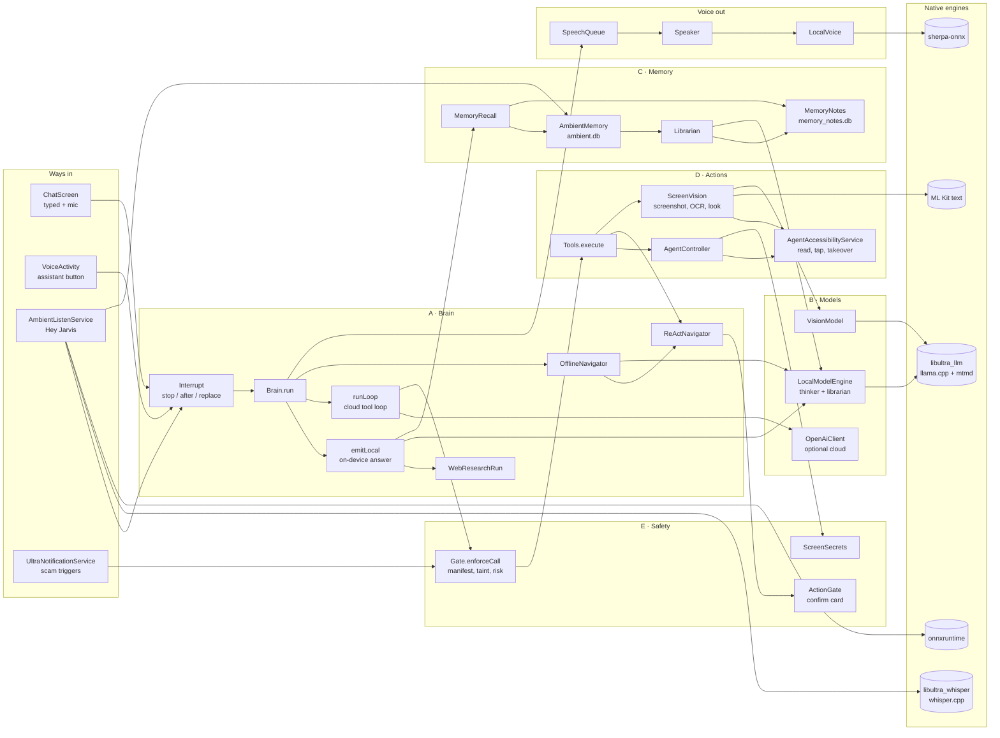
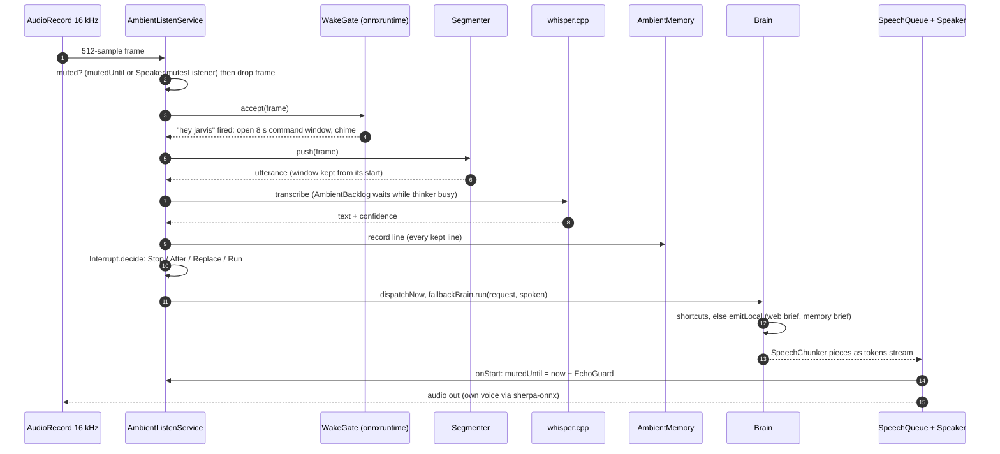
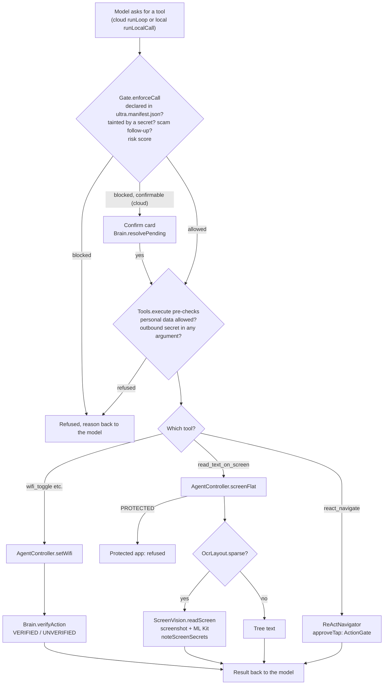
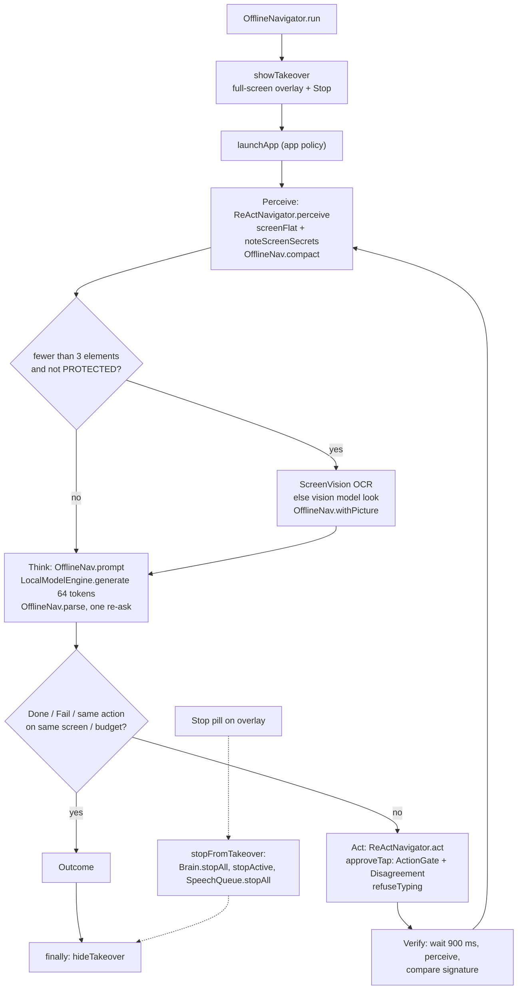
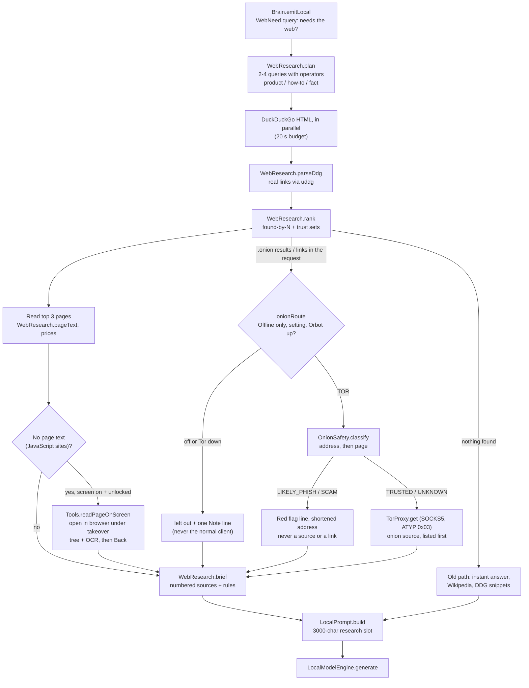
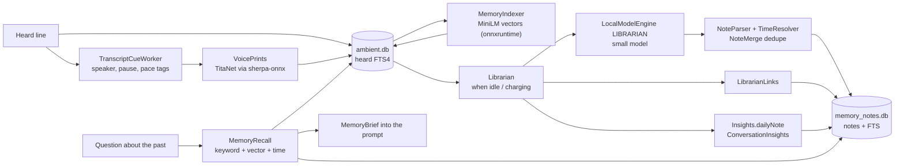
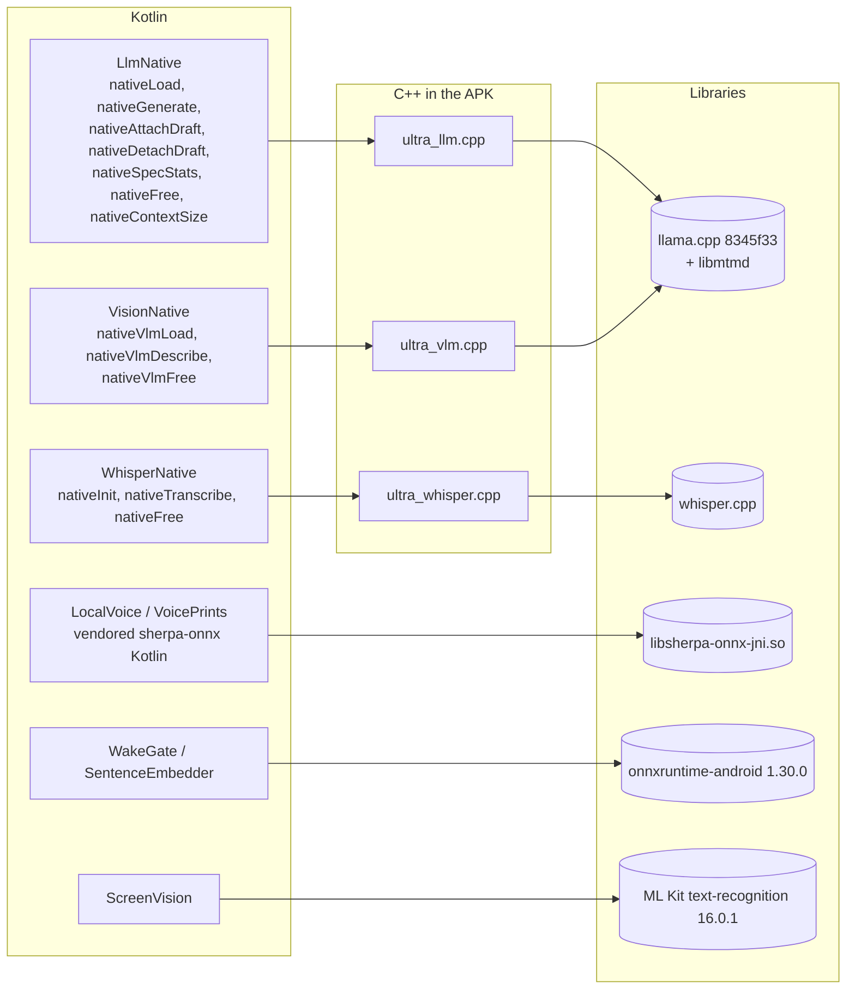
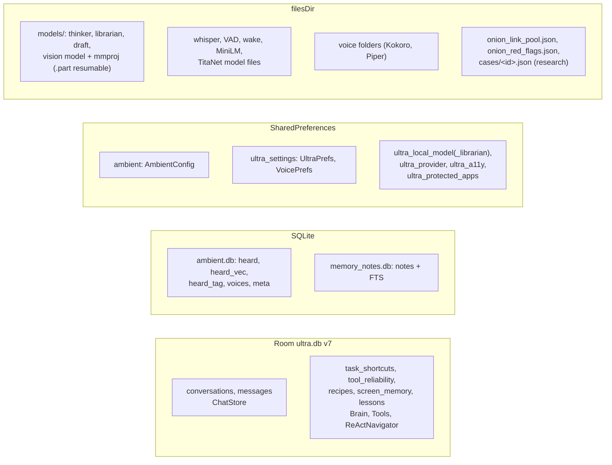
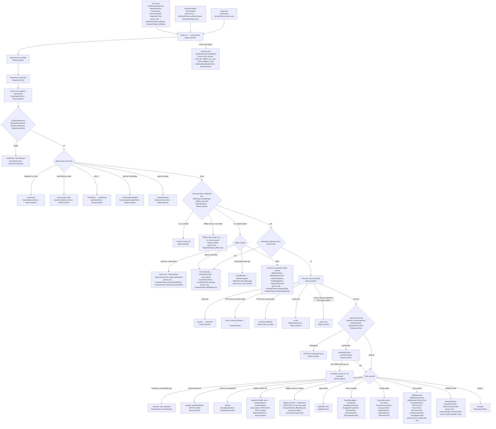

# Jarvis architecture

The skeleton every change is checked against: what each part does and what it talks to. Generated from two read-throughs of the code on 2026-10-07 (every edge names the function it goes through). Diagrams are Mermaid; GitHub renders them.

## Components

### A · Brain

| Part | File | Role |
|---|---|---|
| Brain | `agent/Brain.kt` | Routes each request: shortcuts, on-device answer, cloud tool loop, navigation |
| Interrupt | `agent/Interrupt.kt` | New words mid-run: Stop, After, Replace or Run |
| IntentRouter · WebNeed | `agent/IntentRouter.kt, WebNeed.kt` | Request part, think budget, whether the web is needed |
| LocalPrompt · LocalToolCall | `agent/LocalPrompt.kt, LocalToolCall.kt` | On-device prompts and the local tool catalog |
| OfflineNavigator · OfflineNav | `agent/OfflineNavigator.kt, OfflineNav.kt` | On-device perceive, think, act, verify loop |
| ReActNavigator | `agent/ReActNavigator.kt` | Cloud in-app navigator; owns the shared executeAction |
| WebResearch · WebResearchRun | `agent/WebResearch.kt, WebResearchRun.kt` | Multi-query search, ranking, page reading, brief; onion policy; explicit "deep research" / "investigate" / "verify this product" runs |
| Research over Tor | `research/Forums.kt, Contacts.kt, Discovery.kt, ProductCheck.kt, Investigation.kt` | Forum threads and wiki indexes, bounded onion crawl and link pool, product/company check, investigation case files (drafts-only outreach) |
| Experience · Recipes | `agent/Experience.kt, Recipes.kt, RoutePlayer.kt` | Lessons from runs; saved routines |
| Budgets | `agent/ThinkBudget.kt, WaitBudget.kt, ThermalGuard.kt` | Think tokens, wait time, heat scaling |

### B · Models

| Part | File | Role |
|---|---|---|
| LocalModelEngine | `local/LocalModelEngine.kt` | llama.cpp wrapper: thinker and librarian, download, load, generate |
| LlmNative · CpuVariant · CpuTopology | `local/*.kt` | JNI and picking the fastest CPU build and cores |
| VisionModel · VisionNative | `local/VisionModel.kt, VisionNative.kt` | Qwen2.5-VL 3B: describe a screenshot |
| ParallelDownload · Downloads | `local/ParallelDownload.kt, Downloads.kt` | 4-connection resumable downloads |
| OpenAiClient | `provider/OpenAiClient.kt` | Optional cloud model |

### C · Memory

| Part | File | Role |
|---|---|---|
| AmbientMemory | `listen/AmbientMemory.kt` | ambient.db: heard lines, vectors, tags, voices |
| Librarian | `listen/Librarian.kt, LibrarianText.kt` | Turns heard lines into notes when idle |
| MemoryNotes | `listen/MemoryNotes.kt` | memory_notes.db: notes with full-text search |
| MemoryRecall · MemoryIndexer | `listen/MemoryRecall.kt, MemoryIndexer.kt` | Keyword, vector and time recall |
| ConversationInsights · CueTaxonomy | `listen/ConversationInsights.kt, CueTaxonomy.kt` | Talk statistics and literature-based patterns |
| ChatStore · Room | `ui/ChatStore.kt, data/*` | Chat state and ultra.db |

### D · Actions

| Part | File | Role |
|---|---|---|
| Tools | `agent/Tools.kt` | Tool dispatcher with personal-data and secret checks |
| AgentController | `agent/AgentController.kt` | Device facade: screen, taps, settings, secret tracking |
| AgentAccessibilityService | `AgentAccessibilityService.java` | Reads and drives the screen; takeover overlay; screenshots |
| ScreenVision · OcrLayout | `agent/ScreenVision.kt, OcrLayout.kt` | Screenshot, ML Kit OCR, vision look |

### E · Safety

| Part | File | Role |
|---|---|---|
| Gate | `gate/Gate.kt + Manifest, Contracts, RiskScorer` | Deterministic per-call policy |
| ActionGate · Disagreement | `agent/ActionGate.kt, Disagreement.kt` | Confirm card for commitments; stop on contradiction |
| ScreenSecrets · ScamWatch | `gate/ScreenSecrets.kt, ScamWatch.kt` | Codes and cards stay put; scam follow-ups blocked |
| OnionSafety · TorProxy | `agent/OnionSafety.kt, net/TorProxy.kt` | v3 checksum, lookalike and scam screening (TRUSTED / LIKELY_PHISH / SCAM / UNKNOWN); onion pages only through Orbot's SOCKS proxy, the name never resolved on the phone |

### Voice in and out

| Part | File | Role |
|---|---|---|
| AmbientListenService | `listen/AmbientListenService.kt` | Mic pipeline: gate, wake, whisper, dispatch |
| Segmenter · WakeGate · WakeFilter | `listen/*.kt` | Utterance cutting, wake word, addressed speech |
| WhisperNative · LocalSpeech | `listen/WhisperNative.kt, LocalSpeech.kt` | whisper.cpp speech to text |
| SpeechChunker · SpeechQueue · Speaker | `agent/SpeechChunker.kt, ui/SpeechQueue.kt, ui/Speaker.kt` | Speak as it writes; echo guard |
| LocalVoice · VoiceCatalog | `listen/LocalVoice.kt, VoiceCatalog.kt` | Own voices via sherpa-onnx |

## The whole app

Who starts what. Arrows point from caller to callee. Grey boxes are third-party engines inside the APK.

## Hey Jarvis to a spoken answer

Flow (a)+(b): microphone to command to speech, including the echo guard that stops Jarvis hearing itself.

## A tool call, gate by gate

Flow (c): every safety check a tool call passes before anything happens on the phone.

## On-device app driving

Flow (d): perceive, think, act, verify, with the takeover overlay holding off your touches.

## Searching the web

Flow (e): several searches, ranked by agreement and site trust, pages read, numbered sources.

The brief keeps its top lines (notes, red flags, onion identity, price red flags) and its closing rules when it has to be cut; sources are cut first. For a product or company check ("verifying") the rules lay the evidence out in a labelled mechanical order, say no pick and no purchase advice, and end with a question.

Explicit phrases at the start of a request start bigger runs (`WebResearch.mode`), reached through the same `web_search` / `emitLocal` path, no new tool:

- "verify this product …" / "check this company …" → `ProductCheck`: clearnet leg + onion leg (pages the owner gave, read through Tor, unlisted ones screened first), `companyCheck` (own site, onion published there or not, lookalikes, scam signals), a table sorted by trust tier then price with the key labelled, ending with a question.
- "deep research …" → `Discovery` (needs both "Onion research via Tor" and "Deep research over Tor"): owner's thread URLs read the forums way, wiki indexes screened link by link, a bounded crawl (depth 1, 12 pages, 90 s) from the known-good set + the owner's list + the owner's pages; clean finds saved to `files/onion_link_pool.json`, flags to `files/onion_red_flags.json`. Tor down: stops with a note, no clearnet fallback.
- "investigate …" → `Investigation`: clearnet, articles (contacts with url + snippet + time), Tor (opt-in, as above), OSINT operator queries and pivots; people-search / data-broker / breach sites skipped; case saved to `files/cases/<id>.json`; outreach drafts only, no send path.

## Memory and notes

Flow (c, memory side): what is heard becomes searchable lines, then notes, links and insights.

## Native boundary

Every Kotlin external function and the C++ it lands in. Each .so is built in three CPU flavours (base, dotprod, i8mm); the fastest the phone supports is loaded.

## Where things are stored

Databases, preference files and model files on the phone.

## Verification tree

How each path from a request to an action is checked. Every request enters through `Brain.run` → `runUnlocked` (`agent/Brain.kt`), whose branches run in the order drawn. The one exception is Confirm on a paused action: `Brain.resolvePending` takes the run lock itself and resumes `runLoop` directly, so the per-request steps at the top of `runUnlocked` (stale-pause cancel, `forgetScreenSecrets`, correction, scam warning) do not run again for it. Each leaf names the automated test that checks it (JVM, `./gradlew testDebugUnitTest`), or `phone-only → <probe>` for the on-phone check in `app/src/debug/java/com/agent/ultra/bench/` (`FeatureProbes`, `RealUseProbes`, run from the Test kit). `BrainLoopTest` drives the real `Brain` against a scripted OpenAI-compatible server (`FakeChatServer`) with no on-device model; it is the only test that constructs `Brain`. A classifier test (for example `UserNotesTest`) checks the decision, not the branch that acts on it; the table says which.

Not a branch of `Brain`, but checked alongside it: what leaves the phone in a backup (`res/xml/data_extraction_rules.xml`) is pinned by `DataExtractionRulesTest`.

The native shims under the on-device branches (`ultra_llm.cpp`, `ultra_vlm.cpp`, `ultra_whisper.cpp`) are also driven off the phone by `ultra-native/tools/host-harness` (`run.sh`, `vlm/run_vlm.sh`, `whisper/run_whisper.sh`) with tiny random-weight models: they prove the code paths, never answer quality.

Status words are the honesty statuses of `CLAUDE.md`, tied to how the check runs: **PROVEN (by test)**: a JVM test drives this branch end to end. **PARTIALLY PROVEN**: the decision or the parts are tested, but the branch that acts on them is not driven end to end. **CANNOT VERIFY FROM CURRENT ARTIFACTS (phone-only)**: it needs the real phone (native generation, microphone, accessibility, real settings); the named probe checks it there, and nothing off the phone can. **UNTESTED**: no test and no probe.

| Branch (`Brain.kt`) | How it is verified | Status |
|---|---|---|
| `run` → `runUnlocked`, answer through `onAnswer` | `BrainLoopTest` | PROVEN (by test) |
| Stale `pendingConfirm` cancelled by a new request | `BrainLoopTest.aNewRequestCancelsAStalePause` | PROVEN (by test) |
| `Experience.correction` → lessons | `ExperienceTest` (the decision); the save in `Brain` is not driven | PARTIALLY PROVEN |
| Scam in the request: warning shown and said first | `ScamSignalsTest`; `BrainLoopTest.aScamInTheRequestIsWarnedAboutBeforeTheAnswer` | PROVEN (by test) |
| `tryRecipeShortcut` → `runRecipe` | `RecipeResolveTest`, `RecipeLookupTest`, `RecipeGuardTest`, `RoutePlayerTest`; no test runs a saved recipe through `Brain` | PARTIALLY PROVEN |
| `nameVoice`, last answer noted, insights, open notes/memory screen | `NameInferenceTest`, `NotesFromMemoryTest`, `ConversationInsightsTest`, `MemoryFocusTest`; `BrainLoopTest.theDeterministicShortcutsAnswerWithoutCallingTheModel` drives only the empty-store answers ("I don't have a Speaker 2", "There's no answer to save yet", no conversation yet) and the screen request; renaming a real voice, noting a real answer and insights with data are not driven | PARTIALLY PROVEN |
| `UserNotes.command` → `createNote` | `UserNotesTest`; `BrainLoopTest.aNoteCommandIsSavedWithoutCallingTheModel` | PROVEN (by test) |
| No provider and no on-device model: "I have no brain yet" | `BrainLoopTest.noProviderAndNoLocalModelTellsTheOwnerWhereToGetABrain` | PROVEN (by test) |
| Offline only on (key set, no on-device model): no cloud request, own message | `NetPolicyTest` (truth table); `BrainLoopTest.offlineOnlyNeverCallsTheCloudEvenWithAKey` | PROVEN (by test) |
| Offline only on with an on-device model: nothing reaches the cloud or the web | `RealUseProbes.offlineOnly` (reads the routing audit back) | CANNOT VERIFY FROM CURRENT ARTIFACTS (phone-only → `RealUseProbes.offlineOnly`) |
| Offline only switched on while an action waits: Confirm does not resume the cloud run | `BrainLoopTest.offlineOnlySwitchedOnDuringAPauseDoesNotResumeTheCloudRun` | PROVEN (by test) |
| Routing audit (`GateAuditLog.recordRoute`) | `GateAuditLogRotateTest` (line format, fixed route words, rotation); `BrainLoopTest` reads back `cloud/request` for a cloud answer and no cloud/web line with Offline only on. The on-device routes (`local_answer`, `local_tool`, `offline_nav`, `cloud_fallback_local`) are not driven off the phone | PARTIALLY PROVEN |
| Offline memory/notes focus → `emitLocal` | `MemoryFocusTest`, `MemoryBriefTest` (prompt parts); generation is native | CANNOT VERIFY FROM CURRENT ARTIFACTS (phone-only → `FeatureProbes.memoryRecallReal`, `FeatureProbes.memoryOverviewReal`) |
| `runLocalLoop` / `runLocalCall` / `thinkingToolCall` (offline, and the cloud fast path) | `LocalToolCallTest`, `LocalIntentTest`, `BrainHelpersTest` (bare-call on/off and volume fail closed); generation is native | CANNOT VERIFY FROM CURRENT ARTIFACTS (phone-only → `FeatureProbes.offlineNavLive`) |
| `runOfflineNav` → `OfflineNavigator` | `OfflineNavTest`; `FeatureProbes.offlineNavRules` scores the reply parser only | UNTESTED end to end (no live probe) |
| `emitLocal` (web brief, plain on-device answer) | `WebNeedTest`, `WebResearchTest`, `LocalPromptTest`, `ThinkBudgetTest`, `HistoryPolicyTest`, `NetPolicyTest` (no web with Offline only); generation is native | CANNOT VERIFY FROM CURRENT ARTIFACTS (phone-only → `FeatureProbes.thinkerQuality`, `FeatureProbes.thinkerRegression`) |
| `runLoop`: plain answer, tool call + `buildFeedback`, re-ask on a cut-off call, push once | `BrainLoopTest` | PROVEN (by test) |
| Tool data to the cloud inside `[UNTRUSTED DATA …]` … `[END UNTRUSTED DATA]` (`resultFeedback`) | `BrainHelpersTest` (format, cap, spoofed markers removed); `BrainLoopTest` (the real second request carries it) | PROVEN (by test) |
| `runLoop`: HTTP error with no on-device model | `BrainLoopTest.serverErrorWithNoLocalModelSaysTheModelCallFailed` | PROVEN (by test) |
| `runLoop`: HTTP error with an on-device model → on-device fallback | none | UNTESTED |
| Gate: undeclared tool fed back as `STATUS: blocked` | `GateTest`, `ToolWiringTest`; `BrainLoopTest.undeclaredToolIsFedBackAsBlocked` | PROVEN (by test) |
| Gate: confirmable block → `pendingConfirm` → `resolvePending` (cancel and confirm) | `GateTest`, `ScamGateTest`; `BrainLoopTest` (both) | PROVEN (by test) |
| `Tools.execute`: personal data off | `BrainLoopTest` (the refusal comes back as `STATUS: failed`) | PROVEN (by test) |
| `Tools.execute`: secret in an argument | `SecretEgressTest`, `ScreenSecretsTest` (the parts, not through `Brain`) | PARTIALLY PROVEN |
| `Tools.execute`: missing or unreadable arguments refused, never guessed | `ToolArgsTest`, `ToolsArgsTest` (not through `Brain`) | PARTIALLY PROVEN |
| Device actions (toggles, alarms, volume) + `verifyAction` on the cloud path | none; `FeatureProbes.offlineNavLive` checks the offline `runLocalCall` path only (and skips when the phone is online) | UNTESTED |
| `react_navigate` (ReActNavigator, ActionGate) | `NavigatorFixesTest`, `NavigatorPromptTest`, `NavPlanTest`, `ActionGateTest`, `DirectRequestTest`; not driven through `Brain` | PARTIALLY PROVEN |
| Screen reads, web search, ambient recall, recipes | `ScreenStructureTest`, `OcrLayoutTest`, `RealPageTest`, `NativeAppTest`, `AllFixturesTest`, `WebResearchTest`, `RecallScoreTest`, `MemoryVectorsTest`, `RecipeGuardTest` (the parts, not through `Brain`); recall speed on the phone → `FeatureProbes.memoryScale` (40k synthetic lines) | PARTIALLY PROVEN |
| Onion links in research (`WebResearchRun.onionStep`): setting off → left out + one line; on with Orbot down → left out + one line; on and up → read through the Tor proxy only | `WebResearchOnionTest` (the three routes; a fake SOCKS5 proxy sees the onion name; the normal client refuses onion URLs), `TorProxyTest` (CONNECT uses ATYP 0x03 with the name's bytes, no local DNS lookup); live Orbot on the phone untested | SOURCE-FIXED BUT RUNTIME-UNPROVEN (JVM-proven up to a fake proxy) |
| `OnionSafety` verdicts (v3 checksum, lookalikes, seed-phrase / doubling / impersonation) | `OnionSafetyTest` | PROVEN (by test) |
| Verification brief: labelled order, no pick / purchase advice, closing question, red flags kept when cut | `WebResearchOnionTest`, `WebResearchTest`; what the model then says is not checked | PARTIALLY PROVEN |
| "verify this product …" (`ProductCheck`), "deep research …" (`Discovery`, pool, red-flag log), "investigate …" (`Investigation`, case file, drafts-only outreach) | `ProductCheckTest`, `DiscoveryTest`, `ForumsTest`, `InvestigationTest` with fake fetchers; the `WebResearchRun` wiring and live Tor are not driven | PARTIALLY PROVEN |
| Hey Jarvis → `AmbientListenService` → `Brain.run` | `WakeFilterTest`, `InterruptTest`, `EchoGuardTest`, `SegmenterTest` (parts) | CANNOT VERIFY FROM CURRENT ARTIFACTS (phone-only → `RealUseProbes.loopback`, `FeatureProbes.liveWake`) |
| Assistant button → `VoiceActivity` | none | CANNOT VERIFY FROM CURRENT ARTIFACTS (phone-only → `RealUseProbes.spokenAnswer`, `RealUseProbes.stop`; these build `Brain` directly, not through `VoiceActivity`) |
| Typed text → `ChatScreen` | `ScreensTest` (the screen renders; sending is not driven) | PARTIALLY PROVEN |
