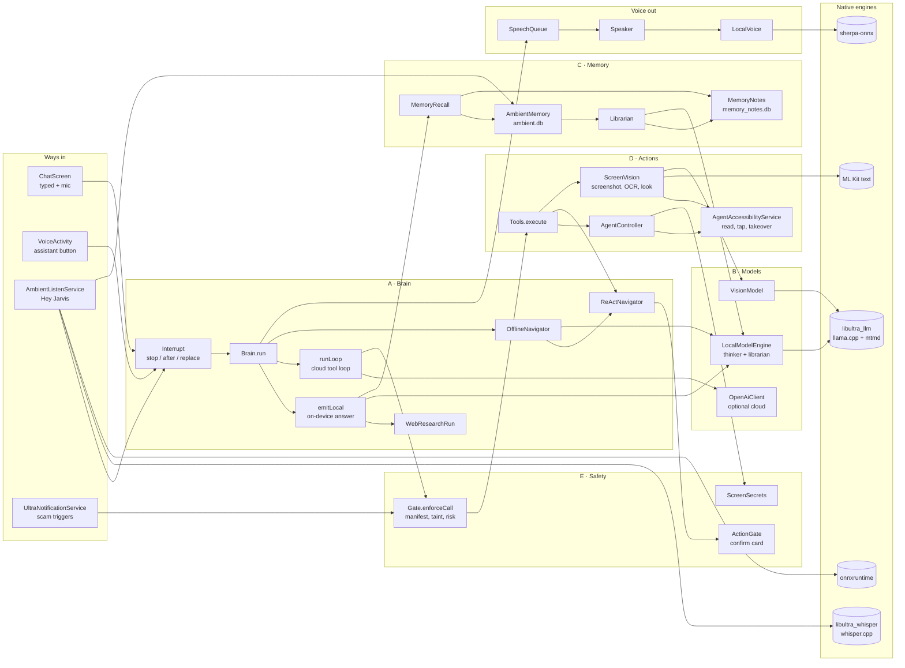
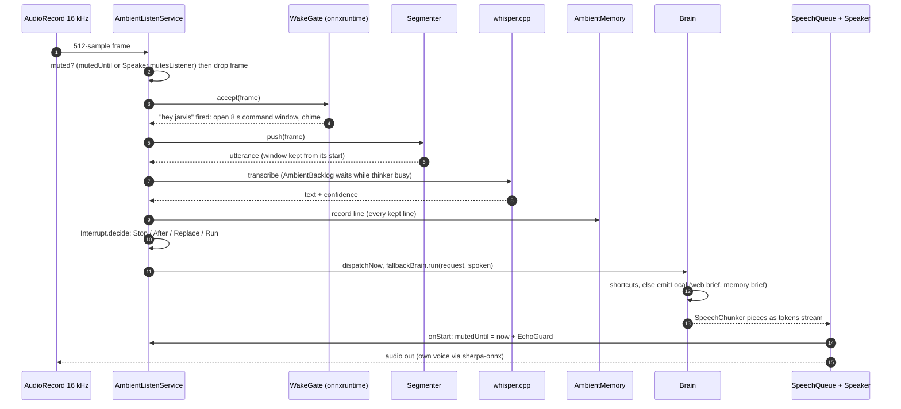
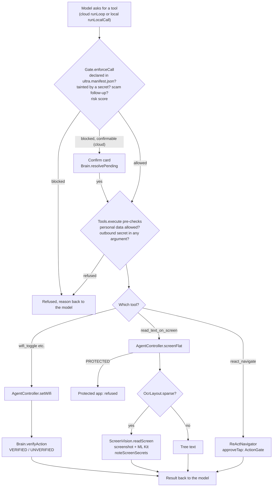
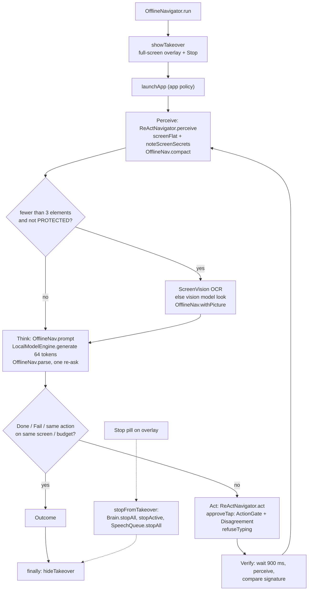
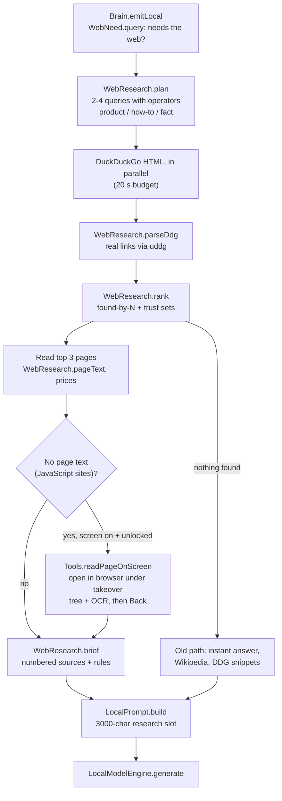
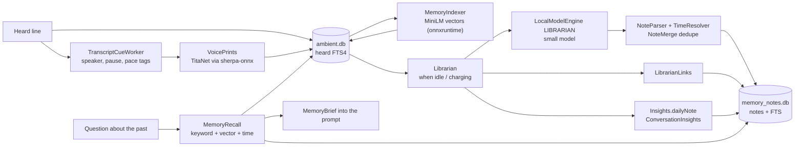
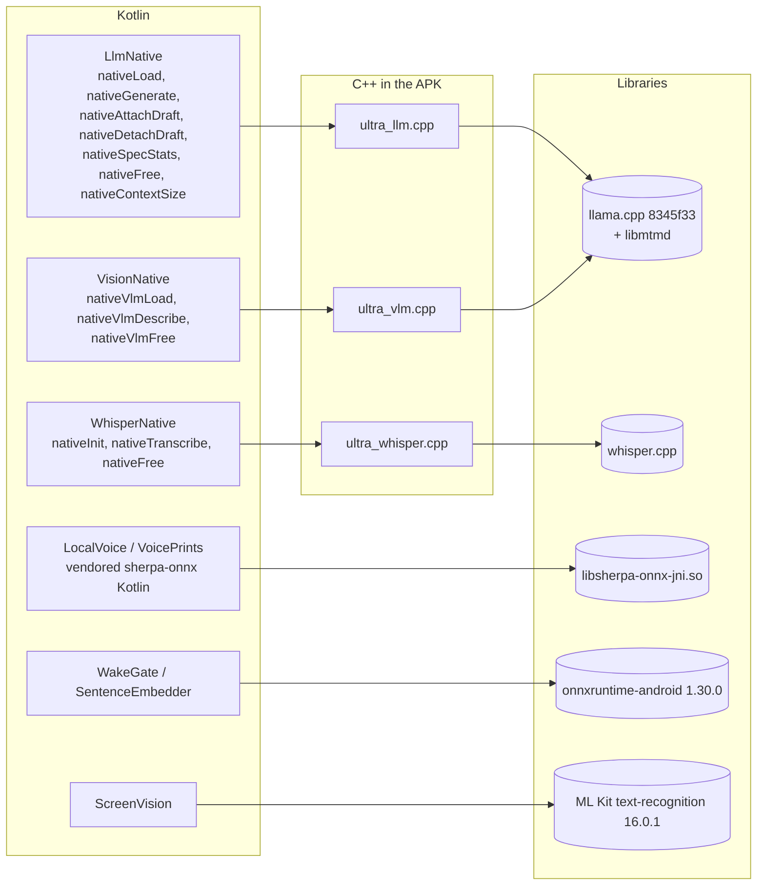
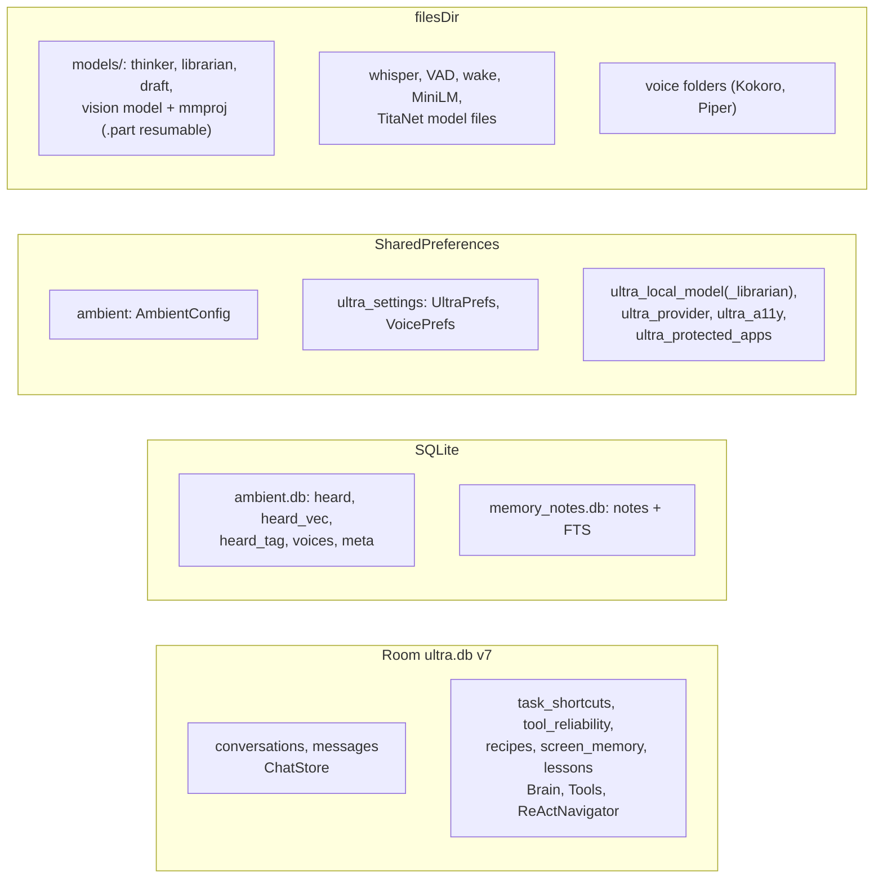

# Jarvis architecture

The skeleton every change is checked against: what each part does and what it talks to. Generated from two read-throughs of the code on 2026-10-07 (every edge names the function it goes through). Diagrams are Mermaid; GitHub renders them.

## Components

### A · Brain

| Part | File | Role |
|---|---|---|
| Brain | `agent/Brain.kt` | Routes each request: shortcuts, on-device answer, cloud tool loop, navigation |
| Interrupt | `agent/Interrupt.kt` | New words mid-run: Stop, After, Replace or Run |
| IntentRouter · WebNeed | `agent/IntentRouter.kt, WebNeed.kt` | Request part, think budget, whether the web is needed |
| LocalPrompt · LocalToolCall | `agent/LocalPrompt.kt, LocalToolCall.kt` | On-device prompts and the local tool catalog |
| OfflineNavigator · OfflineNav | `agent/OfflineNavigator.kt, OfflineNav.kt` | On-device perceive, think, act, verify loop |
| ReActNavigator | `agent/ReActNavigator.kt` | Cloud in-app navigator; owns the shared executeAction |
| WebResearch · WebResearchRun | `agent/WebResearch.kt, WebResearchRun.kt` | Multi-query search, ranking, page reading, brief |
| Experience · Recipes | `agent/Experience.kt, Recipes.kt, RoutePlayer.kt` | Lessons from runs; saved routines |
| Budgets | `agent/ThinkBudget.kt, WaitBudget.kt, ThermalGuard.kt` | Think tokens, wait time, heat scaling |

### B · Models

| Part | File | Role |
|---|---|---|
| LocalModelEngine | `local/LocalModelEngine.kt` | llama.cpp wrapper: thinker and librarian, download, load, generate |
| LlmNative · CpuVariant · CpuTopology | `local/*.kt` | JNI and picking the fastest CPU build and cores |
| VisionModel · VisionNative | `local/VisionModel.kt, VisionNative.kt` | Qwen2.5-VL 3B: describe a screenshot |
| ParallelDownload · Downloads | `local/ParallelDownload.kt, Downloads.kt` | 4-connection resumable downloads |
| OpenAiClient | `provider/OpenAiClient.kt` | Optional cloud model |

### C · Memory

| Part | File | Role |
|---|---|---|
| AmbientMemory | `listen/AmbientMemory.kt` | ambient.db: heard lines, vectors, tags, voices |
| Librarian | `listen/Librarian.kt, LibrarianText.kt` | Turns heard lines into notes when idle |
| MemoryNotes | `listen/MemoryNotes.kt` | memory_notes.db: notes with full-text search |
| MemoryRecall · MemoryIndexer | `listen/MemoryRecall.kt, MemoryIndexer.kt` | Keyword, vector and time recall |
| ConversationInsights · CueTaxonomy | `listen/ConversationInsights.kt, CueTaxonomy.kt` | Talk statistics and literature-based patterns |
| ChatStore · Room | `ui/ChatStore.kt, data/*` | Chat state and ultra.db |

### D · Actions

| Part | File | Role |
|---|---|---|
| Tools | `agent/Tools.kt` | Tool dispatcher with personal-data and secret checks |
| AgentController | `agent/AgentController.kt` | Device facade: screen, taps, settings, secret tracking |
| AgentAccessibilityService | `AgentAccessibilityService.java` | Reads and drives the screen; takeover overlay; screenshots |
| ScreenVision · OcrLayout | `agent/ScreenVision.kt, OcrLayout.kt` | Screenshot, ML Kit OCR, vision look |

### E · Safety

| Part | File | Role |
|---|---|---|
| Gate | `gate/Gate.kt + Manifest, Contracts, RiskScorer` | Deterministic per-call policy |
| ActionGate · Disagreement | `agent/ActionGate.kt, Disagreement.kt` | Confirm card for commitments; stop on contradiction |
| ScreenSecrets · ScamWatch | `gate/ScreenSecrets.kt, ScamWatch.kt` | Codes and cards stay put; scam follow-ups blocked |

### Voice in and out

| Part | File | Role |
|---|---|---|
| AmbientListenService | `listen/AmbientListenService.kt` | Mic pipeline: gate, wake, whisper, dispatch |
| Segmenter · WakeGate · WakeFilter | `listen/*.kt` | Utterance cutting, wake word, addressed speech |
| WhisperNative · LocalSpeech | `listen/WhisperNative.kt, LocalSpeech.kt` | whisper.cpp speech to text |
| SpeechChunker · SpeechQueue · Speaker | `agent/SpeechChunker.kt, ui/SpeechQueue.kt, ui/Speaker.kt` | Speak as it writes; echo guard |
| LocalVoice · VoiceCatalog | `listen/LocalVoice.kt, VoiceCatalog.kt` | Own voices via sherpa-onnx |

## The whole app

Who starts what. Arrows point from caller to callee. Grey boxes are third-party engines inside the APK.

## Hey Jarvis to a spoken answer

Flow (a)+(b): microphone to command to speech, including the echo guard that stops Jarvis hearing itself.

## A tool call, gate by gate

Flow (c): every safety check a tool call passes before anything happens on the phone.

## On-device app driving

Flow (d): perceive, think, act, verify, with the takeover overlay holding off your touches.

## Searching the web

Flow (e): several searches, ranked by agreement and site trust, pages read, numbered sources.

## Memory and notes

Flow (c, memory side): what is heard becomes searchable lines, then notes, links and insights.

## Native boundary

Every Kotlin external function and the C++ it lands in. Each .so is built in three CPU flavours (base, dotprod, i8mm); the fastest the phone supports is loaded.

## Where things are stored

Databases, preference files and model files on the phone.

