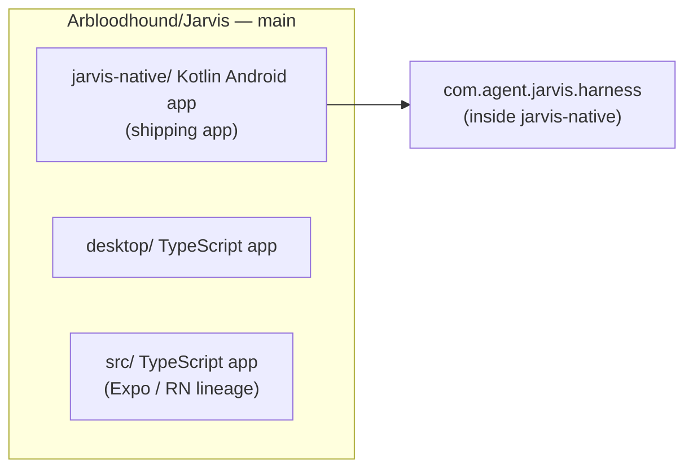
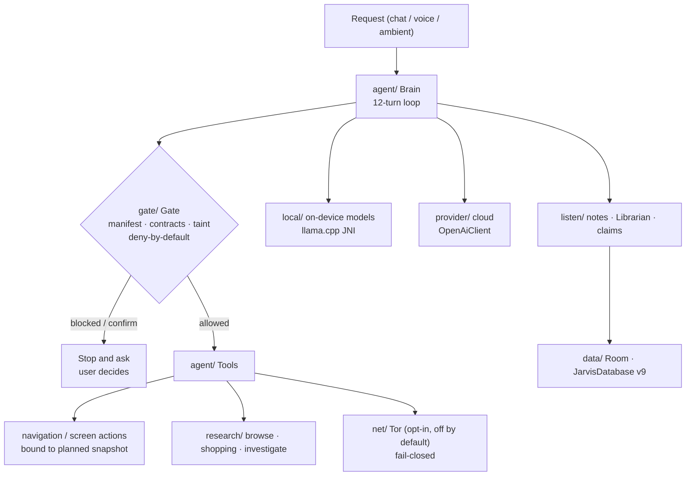
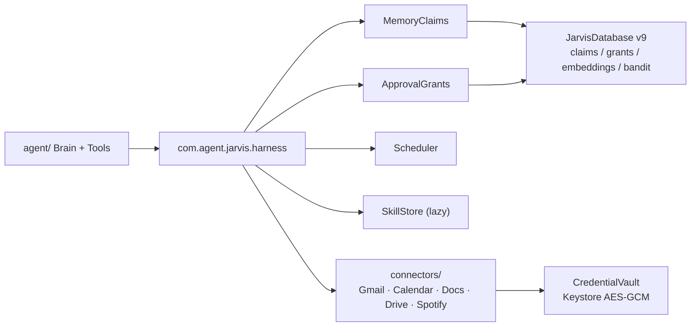

> **Post-merge replacement — 2026-10-19.** Rewritten from the audited state of the code after the 2026-10-19 full-branch consolidation (all work now on `main`). The previous version is preserved at `archive/2026-10-19/ARCHITECTURE.md`. Status claims reflect the 2026-10-19 code audits; CI has not yet compiled the merged tree.

# Jarvis architecture

*Last updated: 2026-10-19. The skeleton every change is checked against: what each part does and what it talks to.*

> **Verification basis.** This replacement is built only from the 2026-10-19 code audits (pass 2 + supplement) and the 2026-10-19 merge log. Audit verification was grep-level — definitions, call sites, and imports — **not compilation**. **CI has not compiled the merged tree**, and Kotlin is source-only until CI runs. The previous version of this document contained a file-by-file component map, call-flow diagrams naming individual functions, a storage map at database v7, and a branch-by-branch verification tree with per-test honesty statuses. Those details were **not re-verified in the 2026-10-19 audits** and have been replaced here with the audited package-level map below. Where the old detail is still needed, consult the archived version — and treat it as unverified against the merged tree.

## Repository shape (post-consolidation)

All work is consolidated on `main` (tip `c8043e1c` — merge commits `ae030b9f` + merge log on top). `claude/shopping-integration` (`adbd9e84`) is also current.

- 58 branches swept: 51 already contained; 2 merged during consolidation (`muse/v5-delta-port` → `claude/shopping-integration`, `4cff5d07`; `ccr-c9b6f798-uako9v` → `claude/shopping-integration`, `adbd9e84`; then `claude/shopping-integration` → `main`, `ae030b9f`); 4 remain unmerged by design: `claude/broken-fixes`, `claude/download-all`, `claude/fast-reasoning` (empty tip commits), `claude/offline-navigation-wip` (superseded WIP snapshot). No branch was deleted; no history was rewritten.
- Post-merge tree:
  - `jarvis-native/` — Kotlin Android app (the shipping app), containing the harness package `com.agent.jarvis.harness`.
  - `desktop/` — TypeScript desktop app.
  - `src/` — TypeScript app (Expo / React Native lineage).

## A · jarvis-native Kotlin app (audited map)

| Package | Role (as audited) | Verdict (merged view) |
|---|---|---|
| `agent/` | Brain (12-turn loop), Tools, navigation | works with defects |
| `gate/` | Gate, Manifest, contracts, taint — deny-by-default | works with defects |
| `listen/` | Ambient listening, speech, notes, Librarian, claim promotion | works with defects |
| `ui/` + `data/` | Screens; Room, `JarvisDatabase` | works as designed within old main alone; `data/` / `JarvisDatabase` works as designed post-merge (see §D) |
| `local/` | On-device models via llama.cpp JNI, downloads | works with defects |
| `net/` | `TorProxy`, `EmbeddedTor`, `TorConnect`, `TorBrowserGuard` | works as designed (Tor property; defects at margins only) |
| `provider/` | `OpenAiClient`, `ProviderConfig` | works with defects |
| `research/` | Browse, shopping, investigate | works with defects |
| `bench/` | Benchmark / probe code (plus tools) | works with defects (bench + tools) |
| (vendored) | sherpa-onnx, vendored | — |
| `src/test/` | Unit tests | **broken** in 2 files (see §F) |
| `src/debug/` | Debug bench (holds `TestKitActivity`, debug-only) | — |

Architectural notes the audits support:

- The Brain loop is a 12-turn loop. Tool calls pass the Gate before execution.
- The Gate is deterministic and deny-by-default: manifest load failure = deny-all; taint blocks can neither be auto-approved nor operator-overridden.
- Screen reads / actions fail closed on protected apps; screen memory stores structure only, no screen text / values. One exception is an open finding: the Kotlin `screenshot` tool bypasses the protected-app check.
- On-device inference is local: models load through llama.cpp JNI. Downloads live in `local/`; their integrity handling is an open finding (see §F).

## B · Harness package `com.agent.jarvis.harness`

The harness lives inside `jarvis-native`. Audited contents:

| Component | Role (as audited) |
|---|---|
| MemoryClaims | Claims with kind / salience / confidence, provenance, supersede chains, hybrid search + query-time temporal decay |
| ApprovalGrants | Grant levels + command binding. Purchases are never grant-coverable; approval tokens are bound to the exact sorted-args key |
| Scheduler + SchedulerRuntime / SchedulerReceiver | Scheduled work. **SchedulerReceiver is not registered in `AndroidManifest.xml`** (see §F) |
| SkillStore | Lazy skills |
| NotificationForwardingPolicy | 3-gate notification forwarding |
| ScreenGuard | Screen protection guard |
| Trash | User-emptied only; no agent-facing empty / purge (structural, reflection-tested) |
| Forget | Forget path (backed by `claimForget()` at the database layer) |
| Subagents | Depth-1 by construction |
| Feed | For You feed surface |
| Ideas | Ideas surface |
| Artifacts | Artifacts surface |
| Proactivity | Proactive behaviour |
| ClaimVerifier | Verification lenses; lenses fail closed |
| NLI head | On-device NLI check |
| bandit (ForYou) | Bandit over feed arms (`BanditArmEntity` / `banditArms()`) |
| connectors/ | Gmail, Google Calendar / Docs / Drive, Spotify. **SpotifyRedirectActivity is not registered in `AndroidManifest.xml`** (see §F) |
| CredentialVault | Keystore AES-GCM vault; agent sees opaque handles only |
| SecretScrubber | Scrubbing + 10-minute placeholder expiry for codes / links, as documented |

Harness verdict: internal logic **works with defects**. The grant keying is called out in the audits as the weak core (grant invariants). No hardcoded secrets were found in the 45 harness files.

## C · Desktop TypeScript app (`desktop/`)

Audited shape:

- Agent loop.
- Gate with **8 ordered checks**. Desktop gate architecture was assessed as strong: layered checks, SSRF defence, redaction in the audit log and confirm cards — despite the desktop findings in §F.
- Providers: Claude cloud + local. **No cross-provider fallback** — a failed turn ends the run.
- Memory: embeddings store / recall; forget moves items to a 500-cap trash.
- Tools, gateway server + CLI.
- Tests in `desktop/test` (7 files). Desktop tests verdict: works as designed (1 low finding).

Verdict: desktop app **works with defects**.

## D · Storage: `JarvisDatabase` v9 (post-merge)

The pass-2 critical defect — harness database wiring missing — is **resolved in the merged tree**. Field-verified by the supplement audit against the harness entities:

- `JarvisDatabase` is **v9** (the previous version of this document said v7; that is superseded).
- Entities include `ClaimEntity` / `GrantEntity` / `MemoryEmbeddingEntity` / `BanditArmEntity`.
- DAO accessors include `claims()` / `claimForget()` / `grants()` / `embeddings()` / `banditArms()`.
- `MIGRATION_7_8` + `MIGRATION_8_9` are defined and registered.

Any other database, preference-file, or model-file inventory from the previous version was not re-verified in the 2026-10-19 audits and is omitted rather than repeated.

## E · TypeScript app (`src/`)

- Live path: `AgentCore` / `BrainExecutor` / `TaskExecutor`. Verdict: **works with defects**. Notable finding: the live path bypasses its own `SafetyChecker` / `PermissionBroker`.
- `server/` is **orphaned / broken**: nothing calls it, it registers no routes, and it crashes at startup in the audited tree.

## F · Audit results and open state

### Counts (do not conflate)

- Pass 2 (main lineage + harness delta): 533 / 536 files read; **119 defects — 1 critical, 16 high, 41 medium, 61 low**; 4 broken-reference clusters; ~70 dead-code candidates.
- Supplement (`ccr` branch, 118 / 118 files): **87 findings — 0 critical, 12 high, 31 medium, 44 low** (+ 6 overflow candidates in `desktop/src`).
- Combined framing: 206 findings across two audits of different snapshots — **not** a deduplicated count of the merged tree.
- Post-merge: **0 known criticals** (the single critical is resolved per §D).

### Still open (post-merge)

- **Manifest wiring (broken):** `SchedulerReceiver` and `SpotifyRedirectActivity` exist in the harness but are not registered in `AndroidManifest.xml`.
- **Kotlin unit tests (broken, 2 files):** `HistoryPolicyTest.kt` / `MemoryBriefTest.kt` import `com.agent.jarvis.bench.TestKitActivity`, which exists only in `src/debug` — the unit-test source set cannot resolve it.
- **TS `server/` (broken / orphaned):** see §E.
- **~70 dead-code candidates** (zero call sites) — candidates only; reflection / JNI / framework callbacks can make some live.
- **Notable highs:** recipe runs can self-confirm steps past the Gate; Gate secret patterns miss phone-shaped secrets (bare OTPs / cards never taint); cloud API key in plaintext SharedPreferences; GGUF downloads verified by size only / no integrity check before native load; voiceprint speaker tags default ON against their own doc comment; desktop broadcasts unredacted tool args to all clients; desktop sends screenshots to cloud Vision ungated; desktop macOS / Windows screen control reports success for actions it didn't perform; Kotlin `screenshot` tool bypasses the protected-app check; ActionGate single global waiter (concurrent Brains can complete each other's questions); raw-coordinate taps ungated when no label within 200px; claim promotion can never supersede and stores a model paraphrase as the claim's verbatim quote; TS live path bypasses its own SafetyChecker / PermissionBroker; harness grant keying is the weak core (grant invariants).

### Checked clean (verified — safe to rely on as audited)

- Tor fail-closed, verified in both audits, three independent guards in `TorProxy`; no clearnet fallback anywhere; only fallback is in-app Tor → Orbot. Tests assert it.
- Gate deny-by-default; taint blocks can neither be auto-approved nor operator-overridden; manifest load failure = deny-all.
- Shopping: onion exclusion is a separate function (`excludeOnion` / `isOnionUrl`) applied by `ShoppingRun`; `ShoppingCheckout` has NO purchase path (prepare / display / track only), by design.
- Harness: purchases are never grant-coverable at either layer; approval tokens bound to exact sorted-args key; Trash has no agent-facing empty / purge (structural, reflection-tested); Subagents depth-1 by construction; SecretScrubber + 10-min placeholder expiry as documented; KeystoreVault AES-GCM; no hardcoded secrets in the 45 harness files; ClaimVerifier lenses fail closed.
- Screen reads / actions fail closed on protected apps; screen memory stores structure only, no screen text / values.
- Desktop gate architecture strong (layered checks, SSRF defence, redaction in audit log / confirm cards) despite the findings above.

### Per-subsystem verdicts (merged view)

- **Works as designed:** `net/` Tor property (defects at margins only), `data/` JarvisDatabase (post-merge), desktop tests (1 low), `ui/` + `data/` within old main alone.
- **Works with defects:** `agent/`, `gate/`, `listen/`, `local/`, `provider/`, `research/`, `bench/` + tools, harness internal logic, desktop app, TS live path.
- **Broken:** Kotlin unit tests (2 files), TS `server/` (orphaned), harness manifest wiring (2 unregistered components).

## G · Cross-cutting flows (audited level only)

### Tor

Tor is opt-in, default OFF. Onion URLs never fall back to clearnet. Research over Tor goes through the Tor path only; if Tor is down, the run stops with a note rather than falling back. Onion exclusion in shopping is a **separate** shopping-layer function (`excludeOnion` / `isOnionUrl`), not a Tor-layer side effect — keep it that way.

### A tool call, gate by gate (summary)

Model asks for a tool → Gate checks manifest, contracts, and taint (deny-by-default) → if blocked as confirmable, the flow stops and asks, and the user decides → if allowed, Tools execute → result returns to the model. Consequential actions (send, post, purchase, delete) stop at confirmation. Purchases always need fresh approval. Screen actions are bound to the snapshot they were planned from; stale screens are refused. Never type into password fields.

Detailed per-function flow diagrams (voice pipeline, web-research ranking, memory / Librarian pipeline, native JNI boundary, on-device navigation loop) from the previous version were not re-verified in the 2026-10-19 audits. They are preserved in `archive/2026-10-19/ARCHITECTURE.md` as unverified reference only.

### Verification

The previous version's branch-by-branch verification tree (each `Brain` branch mapped to named JVM tests and phone probes, with PROVEN / PARTIALLY PROVEN / phone-only statuses) was not re-verified in the 2026-10-19 audits and is not restated here. Current verification facts are only these: audit verification was grep-level; CI has not compiled the merged tree; Kotlin unit tests are broken in 2 files; desktop tests exist in `desktop/test` (7 files, 1 low finding); Tor fail-closed is asserted by tests. Any stronger verification claim needs a CI run or labelled phone evidence first.

## H · Standing rules (architecture must preserve these)

- The agent informs and asks; it does not permit or forbid. Consequential actions (send, post, purchase, delete) stop at confirmation; the user decides.
- Products / shopping = legitimate-product / company verification + scam screening only. "Plugs" = known non-scammers / trusted sources.
- Tor is opt-in, default OFF. Onion URLs NEVER fall back to clearnet. Onion exclusion stays a separate shopping-layer function.
- Human verification (CAPTCHA etc.) is the user's: park with the exact link / action, never solve or bypass.
- Never type into password fields. Screen actions are bound to the snapshot they were planned from; stale screens refused.
- SMS / email codes and reset links never reach the cloud model (opaque placeholder references only).
- Purchases always need fresh approval. No lasting grant covers a purchase, anywhere.
- The agent cannot see the approval card and cannot revoke grants; the user manages grants in settings.
- Credentials live in the platform vault; the agent sees opaque handles only. Trash is emptied by the user in settings, never by the agent.
